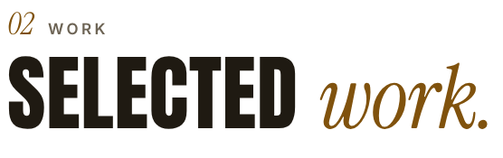
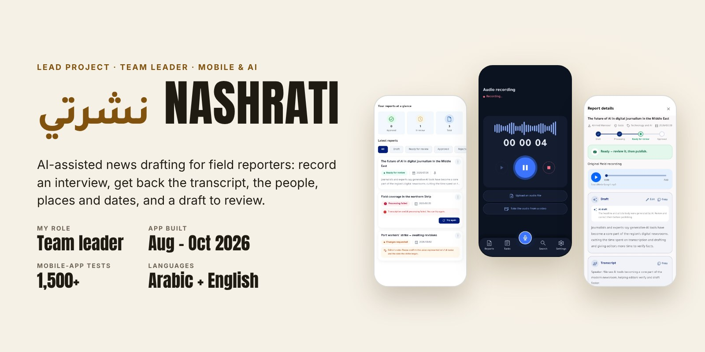
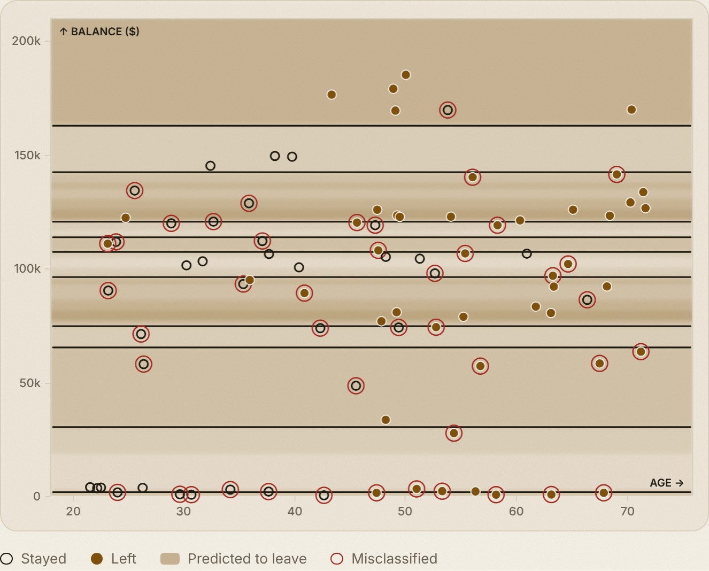
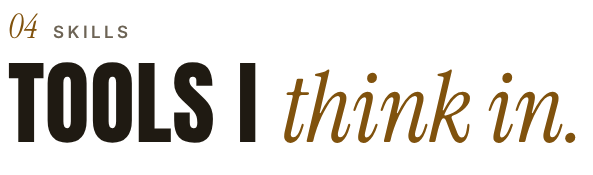

<!-- The same magazine cover as mohammedawad.online, in GitHub's dark and light modes.
     The pictures are rendered from the portfolio's own pages: aborezq/portfolio, _src/readme.js. -->
<a href="https://mohammedawad.online">
  <picture>
    <source media="(prefers-color-scheme: dark)" srcset="assets/cover-dark.jpg">
    
  </picture>
</a>

  

  
  
  
  
  

 

<picture>
  <source media="(prefers-color-scheme: dark)" srcset="assets/title-about-dark.png">
  
</picture>

I'm a **senior in Intelligent Systems and Computer Engineering** at **Al-Aqsa University**, based in
**Gaza, Palestine** — and I'm building my way into tech. My work spans **AI, data analytics and machine
learning**: I train models, ship web and mobile apps, and care about doing the evaluation properly.

My story isn't a straight line. I kept building, studying and shipping through power cuts, unstable
internet and everything that comes with living through a crisis. Half my learning happens offline,
downloaded and read later.

- **Now** — Marketing & Media Lead at  [GDG on Campus Al-Aqsa University](https://gdg.community.dev/gdg-on-campus-al-aqsa-university-gaza-state-of-palestine/), and team leader of **Nashrati**
- **Learning** — data analytics
- **Looking to collaborate on** — AI-powered applications and open-source projects
- **Looking for help with** — taking ML models from notebooks to production
- **Ask me about** — Python, machine-learning pipelines, data analytics
- **Working toward** — becoming an AI engineer · **Pronouns** — he/him

 

<picture>
  <source media="(prefers-color-scheme: dark)" srcset="assets/title-work-dark.png">
  
</picture>

<a href="https://mohammedawad.online/#nashrati">
  <picture>
    <source media="(prefers-color-scheme: dark)" srcset="assets/nashrati-dark.jpg">
    
  </picture>
</a>

**Nashrati** is a team platform in four parts — a Laravel API, a React dashboard, Python AI services and a
Flutter mobile app. I led the team as its team leader, and built the mobile app myself: its architecture,
offline sync, audio capture, and its Arabic and English interface.

| # | Project | What it does | Links |
|:--|:--|:--|:--|
| **01** | **Moodle Watcher** Featured · Automation | Telegram alerts within 20 minutes of anything new on the university's Moodle, deadline reminders through Google Calendar, a channel for classmates, and 68 automated tests. Python · Telegram Bot API · Cloudflare Workers · GitHub Actions | Code is private |
| **02** | **Bank Customer Churn Prediction** Featured · Machine Learning | **0.855 ROC-AUC** and **72.5% recall** on the held-out test set with tuned XGBoost, on an imbalanced churn class. Python · pandas · scikit-learn · XGBoost | [Notebook](https://github.com/aborezq/Bank-Customer-Churn-Prediction/blob/main/Churn_Project_Ai.ipynb) · [Code](https://github.com/aborezq/Bank-Customer-Churn-Prediction) |
| **03** | **Gaza Aid** Featured · Web Product | Humanitarian resources, registration, reporting and request status in one bilingual interface: **5 focused user flows**. HTML · CSS · JavaScript · PHP | [Live](https://aborezq.github.io/Mohammed_Awad_Gaza_Aid/) · [Code](https://github.com/aborezq/Mohammed_Awad_Gaza_Aid) |
| **04** | **Pattern Recognition Research** Featured · Research | When feature scaling changes which classifier is the best choice — and why. | [Paper](https://github.com/aborezq/Pattern-Recognition-Research/blob/main/Pattern_Recognition_Research.pdf) · [Repo](https://github.com/aborezq/Pattern-Recognition-Research) |
| **05** | **ML Research** | A growing collection of machine-learning work: Python, data science, deep learning and data-analysis experiments. | [Paper](https://github.com/aborezq/ML_Research/blob/main/Machine_Learning_Research.pdf) · [Repo](https://github.com/aborezq/ML_Research) |

<b>Earlier coursework</b> — Java, networks and control systems

 

| # | Project | What it does | Links |
|:--|:--|:--|:--|
| **06** | **IT Company** | Java application modeling an IT company: OOP design, class relationships, collections and file handling. | [Code](https://github.com/aborezq/IT-Company) |
| **07** | **Campus Network Design** | A complete campus network in Cisco Packet Tracer: DHCP, RADIUS authentication and WPA2-Enterprise wireless security. | [Topology](https://github.com/aborezq/Networking) |
| **08** | **Library System** | Library management in Java with a clean object-oriented structure for books, members and loans. | [Code](https://github.com/aborezq/Library_System) |
| **09** | **Control System** | Control-system designs for classic automation: a traffic-signal controller and a water-pump controller. | [Code](https://github.com/aborezq/Control-System) |

 

<picture>
  <source media="(prefers-color-scheme: dark)" srcset="assets/title-lab-dark.png">
  
</picture>

The question behind my pattern-recognition research, made playable: the same customers, classified by
k-NN in raw units or with standardized features, with live leave-one-out accuracy for both.
**[Open the Lab →](https://mohammedawad.online/#lab)**

<a href="https://mohammedawad.online/#lab">
  <picture>
    <source media="(prefers-color-scheme: dark)" srcset="assets/lab-dark.jpg">
    
  </picture>
</a>

  

<picture>
  <source media="(prefers-color-scheme: dark)" srcset="assets/title-skills-dark.png">
  
</picture>

  
  
  
  
  
  
  
  
  
  
  
  
  
  
  
  
  
  
  
  
  
  
  

 

<picture>
  <source media="(prefers-color-scheme: dark)" srcset="assets/title-certs-dark.png">
  
</picture>

**32 credentials**, grouped by program. On the site, each one opens the certificate itself and its
verification page.

| Program | Issuer | Certificates |
|:--|:--|--:|
| Google AI Professional Certificate | Google · Coursera | 8 |
| Data Analytics | IBM · Coursera | 6 |
| Claude & AI Fluency | Anthropic | 6 |
| Google AI Essentials | Google · Coursera | 4 |
| Prompting Essentials | Google · Coursera | 3 |
| CodeMap & AI Coding | TAQAT | 2 |
| LangChain · Python | LangChain Academy | 2 |
| Responsible AI | Google Cloud · Coursera | 1 |

**[See every certificate, with its verify link →](https://mohammedawad.online/#certificates)**

 

  <picture>
    <source media="(prefers-color-scheme: dark)" srcset="https://github-readme-stats-five-sigma-99.vercel.app/api?username=aborezq&show_icons=true&count_private=true&hide_border=true&bg_color=00000000&title_color=d9b36a&icon_color=d9b36a&text_color=e8dcc0">
    
  </picture>
  <picture>
    <source media="(prefers-color-scheme: dark)" srcset="https://github-readme-stats-five-sigma-99.vercel.app/api/top-langs/?username=aborezq&layout=compact&langs_count=8&hide_border=true&bg_color=00000000&title_color=d9b36a&text_color=e8dcc0">
    
  </picture>

  <picture>
    <source media="(prefers-color-scheme: dark)" srcset="https://github-readme-activity-graph.vercel.app/graph?username=aborezq&bg_color=00000000&color=a39c8d&title_color=d9b36a&line=d9b36a&point=e8dcc0&area=true&area_color=d9b36a&hide_border=true">
    
  </picture>

 

<picture>
  <source media="(prefers-color-scheme: dark)" srcset="assets/title-contact-dark.png">
  
</picture>

Open to remote opportunities, AI-powered applications and open-source collaboration. Write to me through
[the form on my site](https://mohammedawad.online/#contact), by [email](mailto:momoawad2004@gmail.com), or
on [LinkedIn](https://www.linkedin.com/in/mohammed-r-awad-11a697411).

  <a href="https://mohammedawad.online"><b>mohammedawad.online</b></a> &nbsp;·&nbsp; <a href="https://mohammedawad.online/?lang=ar">بالعربية</a>
   Gaza, Palestine · © 2026 Mohammed R. Awad

