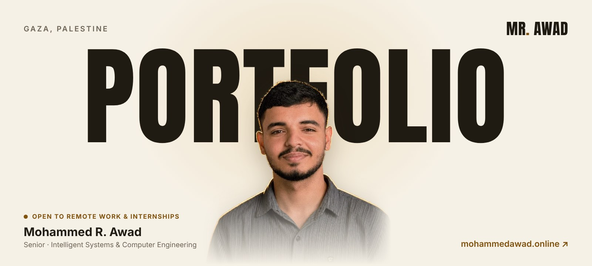
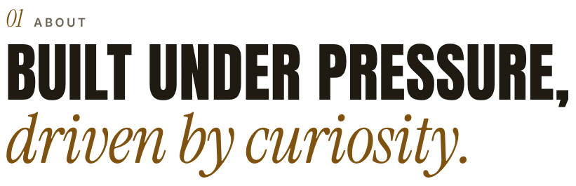
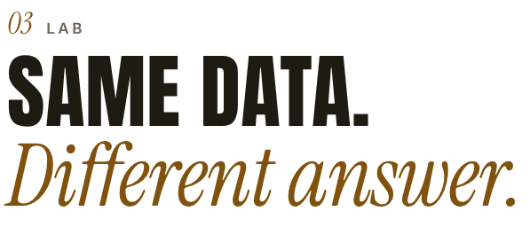
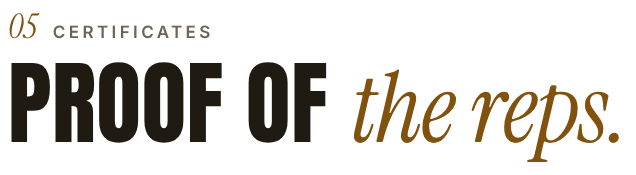
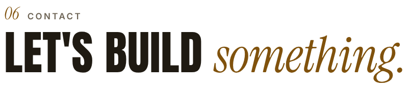

<!-- The same magazine cover as mohammedawad.online, in GitHub's dark and light modes.
     The cover, the Nashrati card, the section titles, the Lab picture and the Arabic roles are
     rendered from the portfolio itself: aborezq/portfolio, _src/readme.js. -->
<a href="https://mohammedawad.online">
  <picture>
    <source media="(prefers-color-scheme: dark)" srcset="assets/cover-dark.jpg">
    
  </picture>
</a>

  <a href="https://mohammedawad.online">
    <picture>
      <source media="(prefers-color-scheme: dark)" srcset="https://readme-typing-svg.demolab.com?font=Inter&weight=500&size=22&duration=2600&pause=900&color=D9B36A&center=true&vCenter=true&width=520&height=44&lines=I+am+a+Computer+Engineer;I+am+a+Team+Leader;I+am+an+AI+Engineer;I+am+a+Problem+Solver">
      
    </picture>
  </a>

<!-- The same line in Arabic, typed right to left as on the site (?lang=ar). A GIF, because
     GitHub cannot run the site's script. -->

  <a href="https://mohammedawad.online/?lang=ar" hreflang="ar">
    <picture>
      <source media="(prefers-color-scheme: dark)" srcset="assets/roles-ar-dark.gif">
      
    </picture>
  </a>

  <b>Open to remote internships and roles in AI, data, and machine learning</b> · graduating&nbsp;July&nbsp;2027

  
  
  
  
  
  

 

<picture>
  <source media="(prefers-color-scheme: dark)" srcset="assets/title-about-dark.png">
  
</picture>

I'm a **senior in Intelligent Systems and Computer Engineering** at **Al-Aqsa University**, based in
**Gaza, Palestine** — and I'm building my way into tech. My work spans **AI, data analytics, and machine
learning**: I train models, ship web and mobile apps, and care about doing the evaluation properly.

My story isn't a straight line. I kept building, studying, and shipping through power cuts, unstable
internet, and everything that comes with living through a crisis. Half my learning happens offline,
downloaded and read later. It made me resourceful and self-taught, and it taught me to finish what I start.

- **Now** — Team Leader of **Nashrati** at TAQAT Academy · Marketing & Media Lead at [ GDG on Campus Al-Aqsa University](https://gdg.community.dev/gdg-on-campus-al-aqsa-university-gaza-state-of-palestine/)
- **Since 2024** — freelance AI design visualization: photorealistic interior concepts for homes, cafés, wedding halls, and event spaces, made with generative-AI image tools
- **Learning** — taking ML models from notebooks to production
- **Ask me about** — Python, machine-learning pipelines, data analytics
- **Languages** — Arabic (native), English (advanced) · **Pronouns** — he/him

 

<picture>
  <source media="(prefers-color-scheme: dark)" srcset="assets/title-work-dark.png">
  
</picture>

<a href="https://mohammedawad.online/#nashrati">
  <picture>
    <source media="(prefers-color-scheme: dark)" srcset="assets/nashrati-dark.jpg">
    
  </picture>
</a>

**Nashrati** takes a field reporter from a recorded interview to a draft an editor can review. It was
built by a team at TAQAT Academy in four parts: a Laravel API, a React dashboard, Python AI services, and a
Flutter app. As team leader, I decide what we build and how the four parts fit together, and I run our
12-week build cycle. The mobile app is my own code — architecture, offline sync, audio capture, and the
Arabic and English interface — with 1,500+ automated tests.

**[Case study and app screens&nbsp;→](https://mohammedawad.online/#nashrati)**

| Project | What it does |
|:--|:--|
| **Bank Customer Churn Prediction** Machine learning · 2026 [Notebook](https://github.com/aborezq/Bank-Customer-Churn-Prediction/blob/main/Churn_Project_Ai.ipynb) · [Code](https://github.com/aborezq/Bank-Customer-Churn-Prediction) | Tuned XGBoost on 10,000 bank customers (about 20% churn), compared with logistic regression, random forest, and a Keras neural network: **0.855 ROC-AUC** and **72.5% recall at 52% precision** on a held-out test set. Python · pandas · scikit-learn · XGBoost · TensorFlow |
| **Pattern Recognition Research** Research · 2026 [Paper](https://github.com/aborezq/Pattern-Recognition-Research/blob/main/Pattern_Recognition_Research.pdf) · [Repo](https://github.com/aborezq/Pattern-Recognition-Research) · [Interactive demo](https://mohammedawad.online/#lab) | Feature scaling can reorder classifiers. On a controlled synthetic dataset, naive Bayes leads on raw features (0.95 accuracy); once they're standardized, **SVM climbs from 0.70 to 0.98** and k-NN from 0.71 to 0.97. k-NN · SVM · logistic regression · decision trees · naive Bayes |
| **Socialty** AI product · Live · 2026 [Website](https://socialty.online/) | Write a post once, and a Gemini-powered agent drafts native versions for LinkedIn, Facebook Pages, and Instagram. It can't approve, schedule, or publish; a person approves the exact version. I'm the product owner: Claude Code agents wrote almost all of the code under my direction, and I run it for our GDG on Campus chapter. React · TypeScript · Laravel · PostgreSQL · Gemini API · Claude Code |
| **Solar Power** Team project · In progress · 2026 [Website](https://solar-power-web.solarpowergaza.workers.dev/) · [Telegram bot](https://t.me/SolarPowerGazaBot) | A free Telegram bot for homes in Gaza that run on solar: every morning, the home's output hour by hour, when its battery will be full, and the best time for heavy appliances. One tap in the evening teaches it each home's correction factor. In a team of two, I built the bot: sign-up, commands, and every Arabic message. TypeScript · Cloudflare Workers · D1 · Queues · Telegram Bot API · Open-Meteo |
| **Moodle Watcher** Automation · 2026 | A Telegram alert within 20 minutes of any new file, assignment, or quiz on the university's Moodle, deadline reminders through Google Calendar, and a channel for classmates. It runs with no server and has 68 automated tests. Python · Telegram Bot API · Cloudflare Workers · GitHub Actions |
| **Gaza Aid Portal** Web · Course project · 2025 [Live front end](https://aborezq.github.io/Mohammed_Awad_Gaza_Aid/) · [Code](https://github.com/aborezq/Mohammed_Awad_Gaza_Aid) | A bilingual (English/Arabic) aid portal with **3 core flows**: register once for aid from several NGOs, check request status by ID or phone, and report a problem, with client- and server-side validation. HTML · CSS · JavaScript · PHP |

<b>More coursework</b> — an ML survey paper, Java, networks, and control systems

 

| Project | What it does |
|:--|:--|
| **Machine Learning Survey** Paper · AI course · 2026 [Paper](https://github.com/aborezq/ML_Research/blob/main/Machine_Learning_Research.pdf) · [Repo](https://github.com/aborezq/ML_Research) | My Artificial Intelligence course paper: the main kinds of machine learning, the architectures that changed the field, where ML is used, and its ethics, with the churn model above as the hands-on part. |
| **Library System** Java · 2025 [Code](https://github.com/aborezq/Library_System) | Built without Java's collections: my own generic stack, queue, linked list, and dynamic array, each used where it fits, behind separate logins for students, employees, and librarians. |
| **IT Company** Java · 2023 [Code](https://github.com/aborezq/IT-Company) | Java application modeling an IT company: OOP design, class relationships, collections, and file handling. |
| **Campus Network Design** Networks [Topology](https://github.com/aborezq/Networking) | A complete campus network in Cisco Packet Tracer: DHCP, RADIUS authentication, and WPA2-Enterprise wireless security. |
| **Control System** Automation [Code](https://github.com/aborezq/Control-System) | Control-system designs for classic automation: a traffic-signal controller and a water-pump controller. |

 

<picture>
  <source media="(prefers-color-scheme: dark)" srcset="assets/title-lab-dark.png">
  
</picture>

The question behind my pattern-recognition research, made playable: one sample of synthetic bank customers,
classified by k-NN twice — in raw units and with standardized features — with live leave-one-out accuracy
for both. **[Open the Lab&nbsp;→](https://mohammedawad.online/#lab)**

  <a href="https://mohammedawad.online/#lab">
    <picture>
      <source media="(prefers-color-scheme: dark)" srcset="assets/lab-dark.jpg">
      
    </picture>
  </a>

 

<picture>
  <source media="(prefers-color-scheme: dark)" srcset="assets/title-skills-dark.png">
  
</picture>

<!-- Each badge links to the site's skills section; a bare image would link to itself on GitHub. -->

  
  
  
  
  
  
  
  
  
  
  
  
  
  
  
  
  
  
  
  
  
  
  
  
  
  

 

<picture>
  <source media="(prefers-color-scheme: dark)" srcset="assets/title-certs-dark.png">
  
</picture>

**32 certificates**, grouped by program.

| Program | Issuer | Count |
|:--|:--|--:|
| Google AI Professional Certificate | Google · Coursera | 8 |
| Data Analytics | IBM · Coursera | 6 |
| Claude & AI Fluency | Anthropic | 6 |
| Google AI Essentials | Google · Coursera | 4 |
| Prompting Essentials | Google · Coursera | 3 |
| CodeMap & AI Coding | TAQAT | 2 |
| LangChain · Python | LangChain Academy | 2 |
| Responsible AI | Google Cloud · Coursera | 1 |

**[See all 32, each with a link to verify it&nbsp;→](https://mohammedawad.online/#certificates)**

 

<picture>
  <source media="(prefers-color-scheme: dark)" srcset="assets/title-contact-dark.png">
  
</picture>

Hiring for an AI, data, or ML internship or role? Building an AI-powered app or an open-source project and
want another pair of hands? Email me at [momoawad2004@gmail.com](mailto:momoawad2004@gmail.com),
message me on [LinkedIn](https://www.linkedin.com/in/mohammed-r-awad-11a697411), or use
[the form on my site](https://mohammedawad.online/#contact).

**[Download my CV (PDF)&nbsp;→](https://mohammedawad.online/assets/Mohammed_Awad_CV.pdf)**

  <a href="https://mohammedawad.online"><b>mohammedawad.online</b></a> &nbsp;·&nbsp; <a href="https://mohammedawad.online/?lang=ar" lang="ar" hreflang="ar">بالعربية</a>
   Gaza, Palestine · © 2026 Mohammed R. Awad

